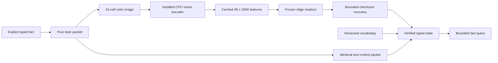

# Architecture

The original idea is to give smaller models usable memory through visual
representations. The implemented system currently separates that question into
three inspectable layers: a typed memory protocol, visual symbol readout, and
conservative state reconstruction.

The model predicts **colors**, not English words or relationships. Software
maps the recovered packet through a fixed codebook. No language-model reasoning
or arbitrary conversation extraction happens in this pipeline.

## Packet and schema

Four bytes encode operation (2 bits), relation (2), subject ID (4), value ID (8),
sequence (8), and nonce (8). A fixed sequence-derived XOR mask whitens the bytes
before they become sixteen two-bit color symbols. This is reversible transport,
not compression. The codebook contains vocabulary, not stored facts.

SET confirms a slot. MAYBE and FORGET make it unknown. Later SET resolves it.
Location and owner remain separate. A query is limited to `Where is ...?` or
`Who owns ...?` using declared names or aliases.

## Visual readout

The frozen readout was selected using training/validation data, before the
reported fresh test. It averages projected features according to cell/tile
area overlap, normalizes them, and applies a per-position ridge classifier.
The bundled NPZ is this small learned readout, not Strata or Qwen weights.
Its fingerprint and training provenance are recorded with the assets.

Each 224-square image has 16 logical cells but 49 exported vision positions.
Source image ingestion and runtime readout are separate: recall reads cached
features, decoder parameters and integrity metadata, never the source PNG.

## Recovery and verification

An exact checksum match is accepted directly. A one-cell policy searches 48
alternatives. A two-cell policy searches 48 + 1,080 = 1,128 alternatives and
accepts only one unique checksum match. No extra image inference or expected
answer lookup occurs. Receipts report distance, repairs and candidate count.

The compact policy uses a 64-bit SHA256 truncation in a distinct versioned
envelope. Shorter tag widths exist only as research controls. The 16-bit
collision fixture deliberately demonstrates false acceptance. Neither full nor
compact checksums authenticate metadata against intentional replacement.

## Journal lifecycle

An append commits pending data before native export. Immutable revision indexes
and an atomically replaced HEAD select the active generation. The index checks
schema, codebook, profile and policy fingerprints; record metadata and features
are checked before readout. A writer lock prevents simultaneous writers.

If **any** active record is pending, absent, corrupt or unrecoverable, the whole
evidence bundle is unavailable. No old state is silently reused. This
conservative policy explains why high per-image accuracy can still lead to
poor long-history availability. Clear starts a new generation but retains
history and scopes source IDs to their generation.

The local prototype does not promise full power-loss recovery or automatic
recovery of abandoned writer locks.

## Relationship to the earlier core

`core/` retains the structured relationship memory, graph reasoning, routing,
and response experiments. Its regression suite still runs. The activation
canvas in that earlier prototype is distinct from direct color-image readout;
its success must not be counted as proof of visual language-model memory.
Historical benchmark drivers live under `research/legacy/`.
